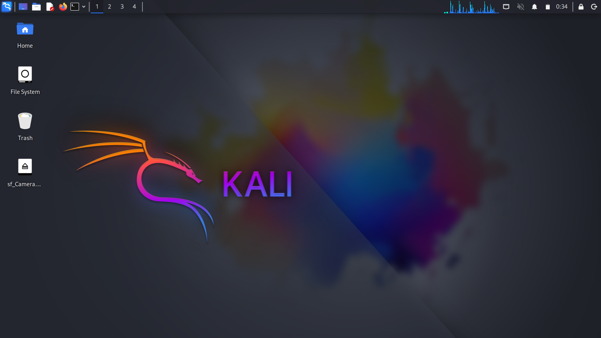
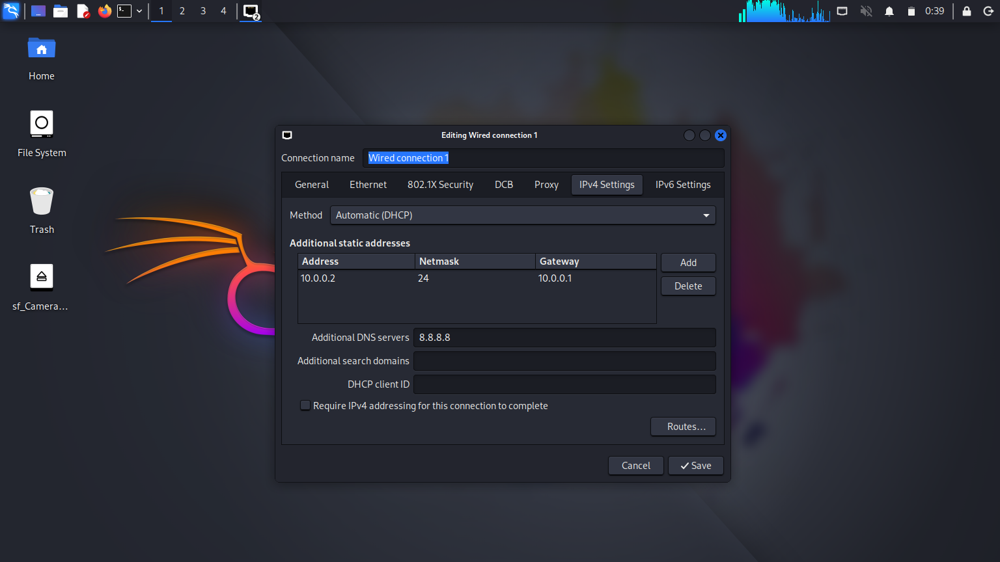
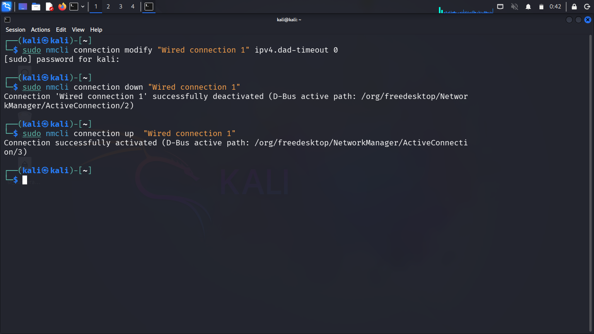

# CyberLab | Kali Linux Virtual Networking Project

<p align="center">
  <strong>A practical cybersecurity learning environment built with Kali Linux and Oracle VirtualBox.</strong>
</p>

<p align="center">
  
  
  
  
</p>

## Project Overview

CyberLab documents the development of a personal cybersecurity practice environment using Kali Linux inside Oracle VirtualBox. It provides a structured place to record virtual machine setup, network configuration, basic diagnostics, troubleshooting, and practical learning outcomes.

This repository is a learning portfolio. Tasks should be marked complete only after they have been performed and verified in the actual lab.

## Learning Objectives

- Set up and configure a Kali Linux virtual machine.
- Explore virtual networking options in Oracle VirtualBox.
- Understand IP addressing, routing, and DNS configuration.
- Practice basic network inspection commands.
- Maintain clear technical notes and troubleshooting records.
- Build a foundation for future defensive security exercises.

## Lab Architecture

```text
Host Computer
     |
Oracle VirtualBox
     |
Kali Linux Virtual Machine
     |
Virtual Network
     |
Network Inspection and Lab Documentation
```

> This is a conceptual overview. Update it if the actual lab configuration differs.

## Tools and Technologies

| Component | Purpose |
| --- | --- |
| Kali Linux | Linux and cybersecurity learning environment |
| Oracle VirtualBox | Virtual machine creation and management |
| Virtual Networking | Network configuration practice |
| GitHub | Version control and project portfolio |
| Markdown | Technical documentation |

## Repository Layout

```text
CyberLab-Kali-VirtualBox-Networking/
├── README.md
├── SECURITY.md
├── CONTRIBUTING.md
├── CHANGELOG.md
├── LAB-NOTES.md
├── docs/
│   ├── installation-guide.md
│   ├── virtual-networking.md
│   ├── troubleshooting.md
│   └── validation-checklist.md
├── screenshots/
│   └── README.md
└── diagrams/
    └── README.md
```

## Getting Started

1. Install Oracle VirtualBox from its official website.
2. Download a Kali Linux image from the official Kali Linux website.
3. Create or import a Kali Linux virtual machine.
4. Configure VM resources and network settings according to the lab requirements.
5. Start the VM and record the configuration actually used.
6. Add genuine screenshots and observations to this repository.

## Basic Network Inspection

Run these commands inside Kali Linux when appropriate for your lab.

Show network interfaces and IP addresses:

```bash
ip address
```

Display the routing table:

```bash
ip route
```

Inspect resolver configuration:

```bash
cat /etc/resolv.conf
```

If connectivity testing is appropriate, check IP reachability and DNS resolution separately:

```bash
ping -c 4 1.1.1.1
getent hosts example.com
```

A failed ping alone does not prove that all connectivity is unavailable; ICMP may be filtered. Record actual output before drawing conclusions.

## Lab Progress

- [ ] Kali Linux virtual machine created and boot-tested.
- [ ] VirtualBox network mode identified and documented.
- [ ] Network interface and IP configuration inspected.
- [ ] Default route reviewed.
- [ ] DNS resolver configuration reviewed.
- [ ] Relevant connectivity checks performed and recorded.
- [ ] Baseline VM snapshot created, if required.
- [ ] Screenshots checked for sensitive information.
- [ ] Documentation updated to reflect verified work.

## Screenshots

The following screenshots demonstrate the Kali Linux setup, VirtualBox configuration, and network settings.

### 1. VirtualBox Homepage


### 2. Kali Linux Homepage


### 3. Network Settings


### 4. IPv4 Configuration


### 5. Running the Given Command


## Documentation

- [Installation guide](docs/installation-guide.md)
- [Virtual networking notes](docs/virtual-networking.md)
- [Troubleshooting guide](docs/troubleshooting.md)
- [Validation checklist](docs/validation-checklist.md)
- [Lab notes](LAB-NOTES.md)

## Responsible Use

This repository is for education and authorized testing only. Use isolated lab systems for security exercises and test only systems you own or have explicit permission to assess.

Do not commit passwords, private keys, access tokens, personal information, or sensitive network details. Review screenshots before publishing.

See [SECURITY.md](SECURITY.md) for repository security guidance.

## Future Learning

- Add a network topology diagram based on the actual configuration.
- Document firewall and host-based security fundamentals.
- Explore defensive log analysis.
- Add further lab exercises with verified observations.

## Project Status

**Status: Learning project.**

## Author

**Name:** Bisma  
**GitHub:** https://github.com/bismaarain  
**LinkedIn:** https://www.linkedin.com/in/bisma-0b8965441?utm_source=share_via&utm_content=profile&utm_medium=member_android  
**Learning Interests:** Cybersecurity | Linux | Networking | Virtualization
